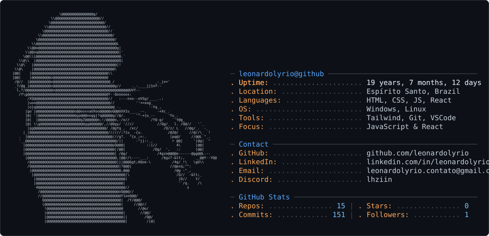

<h3><code>leonardolyrio@github ~ $ ./contributions.sh</code></h3>
<picture>
  <source media="(max-width: 600px)" srcset="contrib-heatmap-mobile.svg">
  
</picture>

  

<h3><code>leonardolyrio@github ~ $ whoami</code></h3>
<picture>
  <source media="(prefers-color-scheme: dark)" srcset="dark_mode.svg">
  <source media="(prefers-color-scheme: light)" srcset="light_mode.svg">
  
</picture>

  

<h3><code>leonardolyrio@github ~ $ ./links.sh</code></h3>

**Frontend Developer · HTML · CSS · JavaScript · React · Tailwind**

[GitHub](https://github.com/leonardolyrio) · [LinkedIn](https://linkedin.com/in/leonardolyrio) · [Email](mailto:leonardolyrio.contato@gmail.com) · [Discord](https://discord.com/users/741416255486951478)

